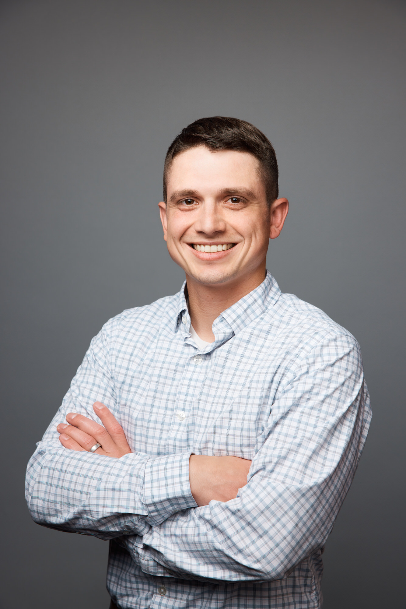

  

  <a href="https://linkedin.com/in/chaz-cornwall-ph-d-a29954185">LinkedIn</a> &nbsp; · &nbsp;
  <a href="https://scholar.google.com/citations?user=X3ht7bwAAAAJ&hl=en">Google Scholar</a> &nbsp; · &nbsp;
  <a href="https://orcid.org/0009-0008-1728-9599">ORCID</a> &nbsp; · &nbsp;
  <a href="https://github.com/chazcornwall">GitHub</a> &nbsp; · &nbsp;
  <a href="mailto:chazcornwall@gmail.com">Email</a> &nbsp; · &nbsp;
  <a href="chaz_cornwall_cv.pdf">Curriculum Vitae</a>

My experience in all facets of autonomy (perception, planning, and localization) as well as my understanding of safety, optimization, and UQ primes future research into trustworthy and integrity-constrained robotics. Since autonomous system safety is conditional on specific assumptions, without online validation of these assumptions, claims of safety are brittle in the real world. Preparation for this type of research stems from my unique (and ever-evolving) journey as a researcher...

My research interests are safety, optimization, state estimation, path planning, uncertainty quantification, and other topics related to GNC. However, I have not always known this :). As an undergraduate at Utah State, I was sure designing electronics for spacecraft was my future. After being involved with the Get-Away-Special (GAS) team and working at the Space Dynamics Laboratory  (since satellites are autonomous systems orbiting earth, I use this year, 2018, in my title). I discovered my true love was software. I then shifted focus and got a job at Autonomous Solutions, Inc, a robotics firm in Mendon, UT working on perception software for mobile robots. This motivated a Master's degree in obstacle detection and state estimation for autonomous vehicles. 

Through all this shifting, I always cared a lot for the safety and integrity of autonomous systems. During my undergraduate degree, a very close friend passed away in a car accident that could have been prevented if driver assistance or autonomy features were available. Towards the end of my Master's degree, I starting diving into optimization, specifically sensor fusion, trying to learn more about redundant and safety systems. In an effort to get closer to autonomy research, I decided to pursue my PhD at Michigan Tech in Michigan's Upper Peninsula (which is still a long 8 hour drive from southeast Michigan, but still had a lot of great programs and connections focused on autonomous vehicles).

As a Yooper (this is what people are called in the Upper Peninsula), I got to work with many undergraduate students and participate in developing an autonomous vehicle for the GM/SAE AutoDrive Challenge II. When I started my PhD, I was planning to work in state estimation, building from my Master's degree. However, due to other opportunities in our lab, my advisor and I thought it best to apply my understanding of uncertainty and optimization to path planning. For my dissertation, I derived a new distribution for modeling path cost and applied the model towards faster modeling of path planners. By this time, I was starting to realize I loved working in robotics because robots do not have to accept their operational domain as uncontrollable. Through an ability to plan and interact with the environment, robots can theoretically change their operational domain to nearly never violate their algorithmic assumptions. This possibility suggests improving and validating robotic algorithms should be much more than just costly, empirical experiments. 

After my PhD, I was fortunate to land a Air Force Science and Technology Fellowship (administered by the NRC) at the Air Force Institute of Technology (AFIT) in the Autonomy and Navigation Technology (ANT) Center. Here, I am working on understanding where conventional methods of UQ and integrity break down in nonlinear, robust state estimation. I am also starting to dive into uncertainty quantification for black-box (aka AI) systems. This is bringing new insights regarding how autonomous systems can have awareness of their limitations, paving a way towards online validation and truly safe autonomous systems.

### Links to some projects

[The Consistency of Symmetric Maximum Likelihood Estimators](https://github.com/chazcornwall/sym_mle_cov_consistency)

[IEEE RAL - Can We Get There Faster: Tuning Sample-based Path Planners](https://github.com/chazcornwall/can_we_get_there_faster)

[EE5531 Kalman Filter Module](https://github.com/chazcornwall/ee5531_state_estimation/tree/main)

[Optimization Examples](https://github.com/chazcornwall/optimization/tree/main)

[Software Stack for GM/SAE AutoDrive Challenge II](https://github.com/chazcornwall/car_ros/tree/main)
